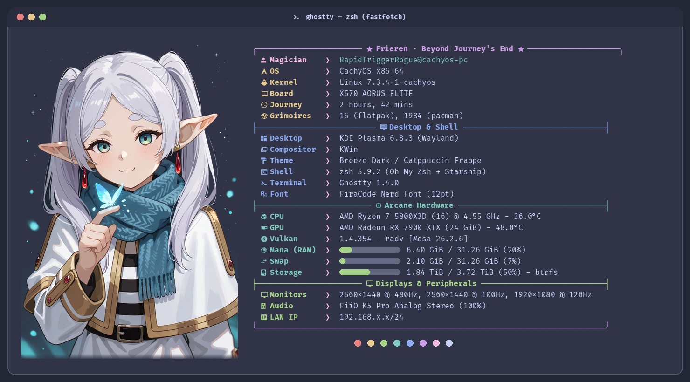

# ✨ Frieren Fastfetch & Ghostty Config (Catppuccin Frappe)

A clean, modern **Fastfetch** + **Ghostty** terminal configuration themed around **Frieren: Beyond Journey's End** (*葬送のフリーレン*) and **Catppuccin Frappe**, optimized for KDE Plasma 6 (Wayland) and Linux desktops.



---

## ✨ Features

- **Custom Alpha-Blended Artwork (`assets/frieren.png`)**: High-resolution transparent RGBA PNG with preserved cyan/blue glowing magic particles that blend seamlessly into semi-transparent terminal backgrounds.
- **Boxed 4-Section Layout (`fastfetch/config.jsonc`)**:
  - **System & Grimoires** (User, OS, Kernel, Board, Uptime, Package counts)
  - **Desktop & Shell** (DE, Wayland Compositor, Theme, Shell, Terminal, Font)
  - **Arcane Hardware** (CPU & GPU with live temperatures, Vulkan driver, pill-shaped progress bars `━━──` for RAM, Swap, and Disk usage)
  - **Displays & Peripherals** (Single-line multi-monitor refresh-rate summary, Audio device + volume bar, LAN IP)
- **Zero-Reflow Image Anchoring**: Uses `"type": "kitty"` + `"position": "left"` (38×28 cells) matching the exact 28-line height of the right-hand info box so the image stays anchored on the left when resizing the terminal window.
- **Modern Ghostty 1.4+ Config (`ghostty/config`)**:
  - Native Wayland KWin background blur (`background-blur = true`, `background-opacity = 0.86`)
  - `term = xterm-ghostty` for full Kitty graphics protocol & TrueColor support
  - Balanced window geometry (`136x38`) and padding so Fastfetch + prompt fit cleanly on launch
  - Live transparency toggle via `Ctrl+Shift+O` and config reload via `Ctrl+Shift+R`

---

## 🚀 Requirements

- [Fastfetch](https://github.com/fastfetch-cli/fastfetch) (`>= 2.20`)
- [Ghostty](https://ghostty.org/) (`>= 1.1`, or Kitty / WezTerm / Konsole with Kitty graphics support)
- **FiraCode Nerd Font** (e.g. `ttf-firacode-nerd` on Arch / CachyOS)

---

## 📦 Installation

### One-Liner / Quick Install

```bash
git clone https://github.com/RapidTriggerRogue/frieren-fastfetch-ghostty.git
cd frieren-fastfetch-ghostty
./install.sh
```

### Manual Installation

```bash
mkdir -p ~/.config/fastfetch ~/.config/ghostty
cp assets/frieren.png ~/.config/fastfetch/frieren.png
cp fastfetch/config.jsonc ~/.config/fastfetch/config.jsonc
cp ghostty/config ~/.config/ghostty/config
```

> **Tip for `.zshrc` / `.bashrc`:**  
> To ensure the terminal graphics buffer is cleanly reset before drawing Fastfetch, add this alias to your shell config:
> ```zsh
> alias ff="printf '\033[2J\033[3J\033[H' && fastfetch"
> ```

---

## ⚖️ License & Fan-Art Disclaimer

- **Configuration Files & Scripts** (`fastfetch/config.jsonc`, `ghostty/config`, `install.sh`): Licensed under the [MIT License](LICENSE).
- **Character & Artwork Disclaimer**:  
  *Frieren* (*葬送のフリーレン / Frieren: Beyond Journey's End*) is the intellectual property of **Kanehito Yamada**, **Tsukasa Abe**, **Shogakukan**, and **Madhouse**.  
  The included illustration (`assets/frieren.png`) is a **non-commercial fan-art tribute** provided solely as a visual example for personal desktop customization. No copyright or trademark infringement is intended.
